# Wireshark: PCAP Analysis

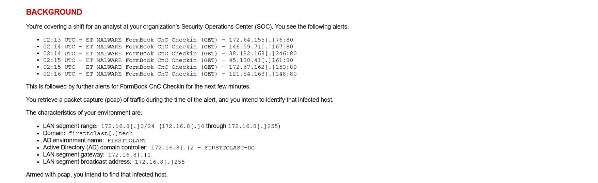

## **Overview:**

For this personal lab project, I worked through a packet-analysis exercise from malware-traffic-analysis.net. The scenario places an analyst on a SOC shift responding to FormBook command-and-control alerts. Using Wireshark in a Kali Linux VM, I analyzed the PCAP to identify the infected Windows client’s IP address, MAC address, hostname, user account name, and the user’s full name, and documented my methods.

Network details:

- LAN: 172.16.8.0/24 (172.16.8 [ . ] 0 through 172.16.8 [ . ] 255)
- Domain: firsttolast[.]tech (AD environment: FIRSTTOLAST)
- Domain controller: 172.16.8.2 (FIRSTTOLAST-DC)
- Gateway: 172.16.8.1
- Broadcast: 172.16.8.255
- Alerts: FormBook CnC check-ins (HTTP GET, port 80) starting around 02:13 UTC, going to several external IPs

## Environment and setup:

<aside>
💡

I initially downloaded Wireshark on my personal machine but since I am working with a potentially malicious file, I analyzed it in an isolated environment such as a VM.

</aside>

Host and VM: VMware Workstation Pro
OS: Linux 6.19.14+kali-amd64
Found by running: `cat /etc/os-release` 

Wireshark ver. 4.6.6

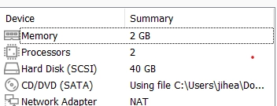

VM Resources:

## File acquisition:

URL: [https://malware-traffic-analysis.net/2026/08/09/index.html](https://malware-traffic-analysis.net/2026/08/09/index.html)

Filename: [**2026-08-09-traffic-analysis-exercise.pcap.zip**](https://malware-traffic-analysis.net/2026/08/09/2026-08-09-traffic-analysis-exercise.pcap.zip) 

VM path: ~jasmine/Downloads/[**2026-08-09-traffic-analysis-exercise.pcap.zip**](https://malware-traffic-analysis.net/2026/08/09/2026-08-09-traffic-analysis-exercise.pcap.zip) 

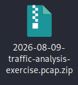

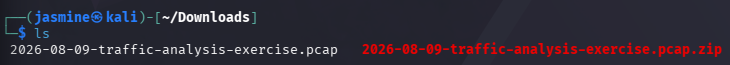

The zipped and unzipped files

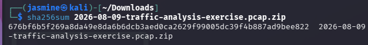

Zip file hash integrity

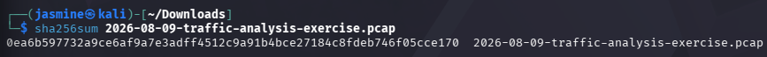

Unzipped file hash integrity 

## My first look at the capture:

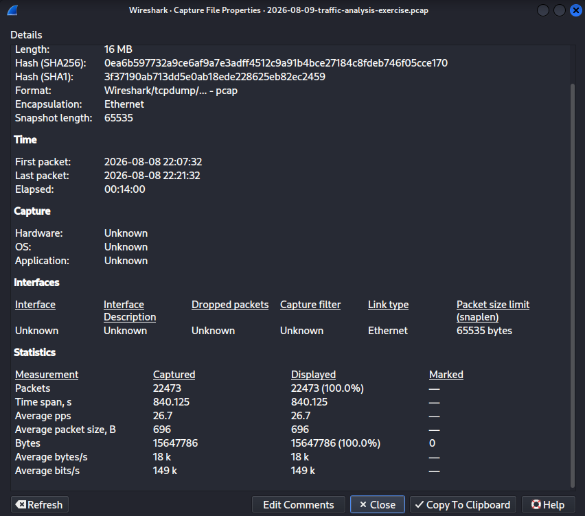

Capture File Properties 

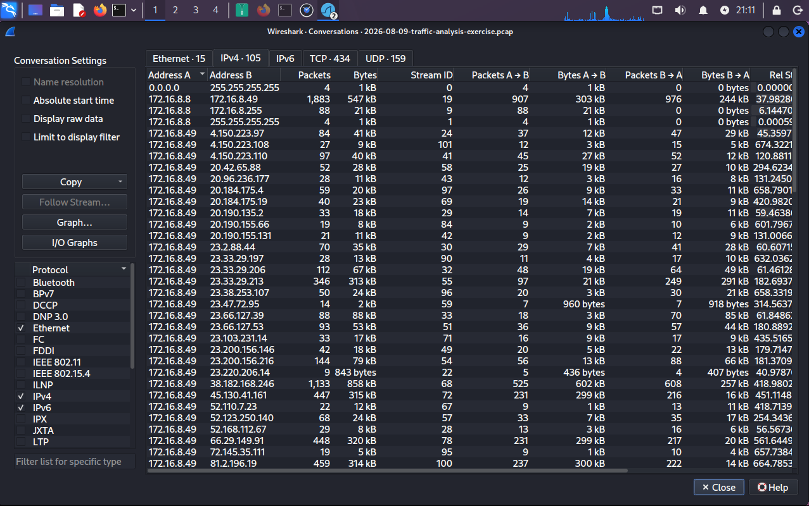

Conversations

## Summary of findings:

| Question | Answer | Evidence | Filter/feature used |
| --- | --- | --- | --- |
| IP address of infected client | 172.16.8.49 | The host sends DNS queries (port 53/UDP) to 9 distinct external IPs

Conversation specifically to 38.182.168.246 is 1,133 packets  | Created filter: ip.src_host ==172.16.8.49

Statistics → conversations → UDP, then looked at the destinations that are external |
| MAC address | 00:12:f0:28:d4:34 | Has the most packets sent from A→ B (6502) | “Ethernet II” line has the mac address then I jumped to one of the packet numbers (Go → Go to packet) |
| Host name | DESKTOP-5NLV63K | The NetBIOS Name Service has the infected desktop hostname registered since it’s a Windows device | nbns |
| User account name | rvance | Creating a filter for Kerberos traffic and creating a column showed the name as “rvance”
The infected IP has the same name | kerberos.CNameString filter |
| Full name of user | Raymond Vance | The QueryUserInfo Full Name response is “Raymond Vance” | Filter:
samr.samr_UserInfo21.full_name == "Raymond Vance” |

## Analysis steps:

**What is the IP address of the infected Windows client?**
Started by looking at the conversations of the pcap and looking through to see which ones had communication outside of the main segment range.

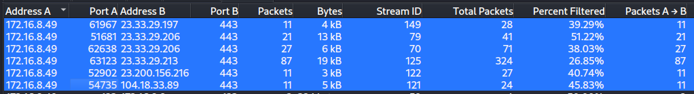

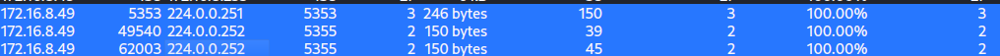

172.16.8.49 had communication with 9 external IPs

**What is the MAC address of the infected Windows client?**
By clicking into a packet from the host, then reading the MAC from the Ethernet II layer, I saw 00:12:f0:28:d4:34

**What is the hostname of the infected Windows client?**
The infected client is a Windows device, so all of the other devices are on NetBIOS traffic for hostnames. Using the infected client’s IP, I was able to use `nbns` to find the hostname.

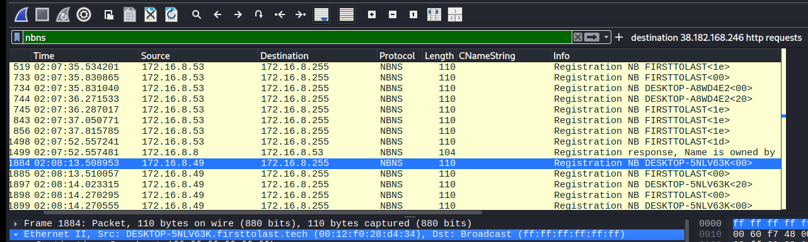

**What is the user account name from the infected Windows client?**

I created a filter for Kerberos traffic called kerberos.CNameString. This filter showed me the user account names and I matched them to the infected host IP.

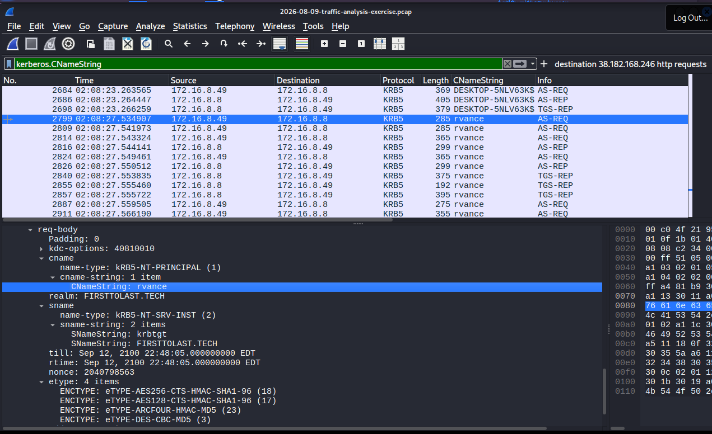

**What is the full name of the user from the user account?** 

Since I already had the last name of the user, I created a case-sensitive search for the string “Vance”
**samr.samr_UserInfo21.full_name == "Raymond Vance"**

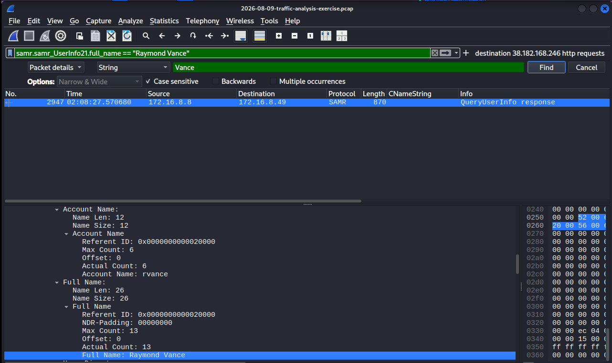

## Troubleshooting issues:

Could not get the pcap file to open using the Wireshark command in Linux at first and figured out the zip file had to be unzipped for it to be opened. Wireshark cannot recognize zip files.

## What I learned:

- How to isolate a single host's traffic from a full network capture using display filters and conversation statistics
- That anomalous outbound DNS volume and destination diversity are stronger indicators of compromise than packet count alone
- How to build a complete identity chain (IP → MAC → hostname → user) by correlating different protocol layers (Ethernet, NBNS, Kerberos, SAMR)
- The importance of verifying file integrity and working in an isolated environment before opening a potentially malicious capture
- How to structure findings so another analyst could reproduce every step from the filter and packet reference